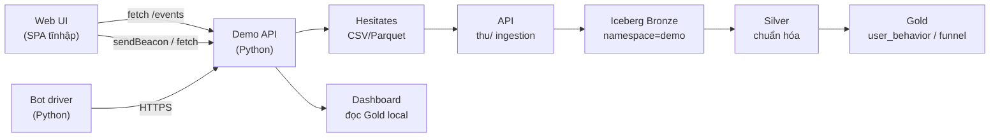

# Kế hoạch website demo thu thập hành vi người dùng

Tài liệu này lập kế hoạch cho một website demo dùng để **phát sinh sự kiện hành vi
người dùng** (page view, click, scroll, add-to-cart, purchase…) và gửi về pipeline
Customer Data Platform. Mục tiêu là có một mặt phát sự kiện chuẩn hóa, có thể
chạy lặp và replay, đồng thời cung cấp dữ liệu mẫu có kiểm soát cho khảo sát
batch Lakehouse và (giai đoạn sau) cho luồng CDC.

Kế hoạch này bổ sung cho [`project-plan.md`](project-plan.md) và
[`development-guide.md`](development-guide.md), không thay thế các quy tắc
nguồn hay data contract. Mọi số liệu hiệu năng trong tài liệu là mục tiêu,
chưa đo.

## 1. Mục tiêu

- Cung cấp một giao diện web thật (catalog sản phẩm, trang chi tiết, giỏ hàng,
  checkout) để phát sinh sự kiện hành vi giống thương mại điện tử.
- Mỗi sự kiện phải có schema thống nhất, timestamp UTC, danh tính ổn định và
  nhận diện được session, đảm bảo khớp được với data contract REES46 đang dùng
  trong repo.
- Hỗ trợ cả chế độ "bấm tay" (duyệt thủ công) lẫn chế độ "chạy kịch bản" (bot
  mô phỏng theo profile định sẵn) để sinh khối lượng lớn phục vụ benchmark.
- Tách biệt rõ phần **phát sự kiện** (client) và phần **thu sự kiện** (server
  + bridge sang pipeline), để có thể thay sink cuối (CSV local, REST, Kafka,
  PostgreSQL) mà không sửa UI.

## 2. Phạm vi hiện tại

- Một catalog sản phẩm mẫu dựng từ tập `product_id` có trong batch 100.000 user
  REES46; không lấy giá/doanh thu REES46 làm nguồn chính cho demo.
- Lưu lượng sự kiện phát ra: mục tiêu 1.000–10.000 sự kiện/phút ở chế độ
  bot, để so được với mẫu batch Lakehouse hiện có.
- Lưu trữ sự kiện ở CSV/Parquet local theo schema contract, idempotency theo
  `(namespace, file_checksum, ordinal)` — giống nguyên tắc REES46 contract.
- Cung cấp dashboard thuần client để xem lại sự kiện vừa phát và tổng hợp
  theo user/session/event_type.
- Có kịch bản seed cố định để chạy lại được phát sinh, có manifest cùng
  checksum nguồn đầu vào.

Không bao gồm trong phạm vi hiện tại:

- Liên kết danh tính với REES46 gốc hoặc PostgreSQL nghiệp vụ; user_id demo
  được sinh độc lập.
- Gửi trực tiếp vào Iceberg hay Kafka từ web; cần sink bên ngoài đứng riêng.
- Đánh giá bảo mật, auth doanh nghiệp, GDPR/cookie consent đầy đủ.

## 3. Người dùng và kịch bản

| Người dùng | Mục tiêu | Kịch bản chính |
| --- | --- | --- |
| Người xem hàng (visitor) | Duyệt catalog, xem chi tiết, thêm giỏ | 3–7 page view, 0–2 add-to-cart |
| Khách mua (buyer) | Thanh toán giỏ | Có ít nhất 1 purchase_observed |
| Người chạy benchmark (operator) | Sinh khối lượng lớn, kiểm soát seed | Bot chạy theo profile 60/30/10 |
| Người xem dashboard (analyst) | Xem sự kiện và tổng hợp ngay trên web | Trang dashboard đọc từ batch local |

## 4. Sự kiện và schema

Sự kiện web dùng chung namespace `cdp.demo.events` và namespace phụ
`cdp.demo.funnel` cho funnel. Schema mỗi sự kiện:

```text
event_id        Chuỗi SHA-256(namespace + batch_checksum + ordinal)
event_time      ISO 8601 UTC, độ phân giải mili-giây
event_type      product_view | add_to_cart | remove_from_cart
                | begin_checkout | purchase_observed | page_view
                | element_click | scroll_depth | search | error
session_id      Chuỗi UUID v4 sinh phía trình duyệt
user_id         Chuỗi pseudo, định danh từ cookie local
namespace       "cdp.demo.events" hoặc "cdp.demo.funnel"
source          "web-demo"
url             URL hiện tại của trang
referrer        URL trang trước (nếu có)
user_agent      Trình duyệt client gửi kèm
viewport        "WxH" viewport lúc phát sự kiện
payload         JSON tùy theo event_type (xem bảng dưới)
quality_flags   Danh sách cờ chất lượng, ví dụ: missing_session,
                zero_price, missing_user_id
ordinal         Số thứ tự trong batch hiện hành (do server gán)
batch_id        UUID của batch hiện hành (do server gán)
ingestion_time  Thời điểm server nhận, ISO 8601 UTC
```

Chi tiết `payload` theo `event_type`:

| event_type | Trường payload chính |
| --- | --- |
| `product_view` | `product_id`, `category_id`, `price`, `currency` |
| `add_to_cart` / `remove_from_cart` | `product_id`, `quantity`, `price`, `currency` |
| `begin_checkout` / `purchase_observed` | `cart_id`, `items[]`, `total_price`, `currency` |
| `page_view` | `path`, `title`, `duration_ms` |
| `element_click` | `selector`, `text`, `tag` |
| `scroll_depth` | `percent`, `path` |
| `search` | `query`, `result_count` |
| `error` | `message`, `stack`, `path` |

## 5. Kiến trúc



- **Web UI**: một SPA nhỏ (HTML + JS module, không framework nặng) phục vụ các
  trang catalog, product detail, cart, checkout và dashboard mini.
- **Demo API**: dịch vụ Python nhẹ nhận sự kiện, gán ordinal và batch_id,
  checksum từng phần, ghi CSV/Parquet xuống `data/demo-events/<batch-id>/`.
- **Bot driver**: script Python chạy ngoài dùng profile người dùng để sinh sự
  kiện song song (mục tiêu 1.000–10.000 sự kiện/phút).
- **Bridge sang Lakehouse**: job Spark giống hệt cách nạp REES46, đọc
  `data/demo-events/<batch-id>/` rồi ghi vào Bronze/Silver/Gold của CDP.
- **Dashboard mini**: trang tĩnh đọc Gold CSV đã export để vẽ biểu đồ.

## 6. Luồng dữ liệu chi tiết

1. Trình duyệt mở trang chủ; client sinh `user_id` (cookie local, ổn định
   90 ngày) và `session_id` (UUID mới mỗi phiên). `batch_id` là session-level
   tạm thời cho đến khi client flush.
2. Mỗi hành động người dùng tạo một sự kiện; client gom theo nhịp 5 giây hoặc
   khi `beforeunload` rồi gửi bằng `navigator.sendBeacon` hoặc `fetch` với
   `keepalive: true`.
4. Mỗi nhận được, Demo API:
   - Bổ sung `ingestion_time`, `ordinal` (tăng dần trong batch hiện hành),
     `quality_flags` dựa trên schema và quy tắc contract.
   - Tính checksum của payload trước khi ghi; checksum nguồn batch là SHA-256
     file CSV sau khi flush đóng.
   - Ghi append vào `events-<batch-id>.csv` (hoặc Parquet khi đủ 1.000 dòng).
5. Khi đóng batch (theo thời gian hoặc số dòng), API ghi `manifest.json` với
   checksum nguồn/output, số dòng theo `event_type`, tỷ lệ thiếu user_id/
   session_id và số user/session duy nhất.
6. Job ingestion batch (Spark) đọc `data/demo-events/<batch-id>/`, ghi vào
   Iceberg Bronze (`cdp.bronze.demo_events`), Silver (`cdp.silver.demo_events`),
   Gold (`cdp.gold.demo_user_behavior`, `cdp.gold.demo_session_funnel`) theo
   đúng quy tắc contract.
8. Dashboard mini đọc CSV Gold vừa export hoặc gọi API tổng hợp để hiển thị.

## 7. Cấu trúc thư mục dự kiến

```text
src/demo/                            # Mã nguồn cho website demo
├── web/                             # SPA tĩnh phục vụ qua http.server
│   ├── index.html
│   ├── catalog.html
│   ├── product.html
│   ├── cart.html
│   ├── checkout.html
│   ├── dashboard.html
│   ├── js/
│   ├── css/
│   └── assets/                      # Ảnh và dữ liệu sản phẩm tĩnh
├── api/                             # Dịch vụ thu sự kiện
│   ├── server.py
│   ├── ingest.py                    # Ghi CSV/Parquet + manifest
│   ├── catalog.py                   # API đọc catalog sản phẩm
│   └── tests/
├── bot/                             # Driver sinh sự kiện theo profile
│   ├── driver.py
│   ├── profiles.py
│   └── scenarios.py
├── lakehouse/                       # Job Spark nạp demo vào Iceberg
│   ├── ingest_demo.py
│   └── sql/
└── docs/                            # README + ghi chú vận hành

config/demo/                         # Cấu hình riêng cho demo
├── catalog.products.json            # Danh sách sản phẩm tĩnh
├── scenarios/                       # Kịch bản bot theo profile
└── server.env                       # Biến môi trường API

data/demo-events/                     # CSV/Parquet do API ghi (không Git)
data/reports/demo/                   # Báo cáo sinh từ job
```

Cấu trúc này bổ sung, không thay thế `src/pipelines/`, `src/tools/`, `config/`,
`data/` hiện có. Mọi batch demo phải đặt trong `data/demo-events/<batch-id>/`
tương tự `data/local-batches/rees46/<batch-id>/`.

## 8. Quy tắc xử lý (data contract demo)

Áp dụng cùng nguyên tắc với contract REES46:

- Timestamp UTC, không làm tròn chuỗi quá mili-giây; phân biệt `event_time`
  client và `ingestion_time` server.
- Giá decimal(18,2); currency bắt buộc đi kèm khi có giá; không suy ra
  currency từ context khác.
- Thiếu `session_id` vào quarantine, báo số lượng; thiếu `user_id` cũng vào
  quarantine theo chế độ `--strict-user` (mặc định bật).
- Hai payload bằng nhau không tự bị loại; ordinal phản ánh thứ tự thật.
- `event_type` không thuộc danh sách hỗ trợ vào quarantine.
- Rerun API: kiểm checksum nguồn, nếu đã có batch_id tương ứng thì bỏ qua;
  nếu khác nội dung thì tạo batch mới, không ghi đè.
- Một writer ở API mỗi lúc; commit nguyên tử theo batch (flush CSV đóng rồi
  ghi manifest).
- Funnel grain `batch_id/namespace/user_id/session_id`; view → cart →
  purchase phải thời gian tăng nghiêm ngặt.

## 9. Công nghệ và lựa chọn (đề xuất)

Mục này gợi ý stack phù hợp với phạm vi; người dùng sẽ chốt khi triển khai.

- **Web**: SPA tĩnh (HTML + module JS) phục vụ qua `http.server` của venv hiện
  có; tránh thêm framework nặng. Dùng `Chart.js` hoặc `ECharts` cho dashboard
  mini.
- **API**: Python (FastAPI hoặc Starlette) chạy trong `.venv` hiện tại, dùng
  DuckDB để ghi Parquet nếu muốn tối ưu tốc độ ghi; không cần Spark trong
  API.
- **Bot driver**: Python đa tiếp trình hoặc `asyncio` + `httpx`, dùng cùng
  `.venv` hiện tại. Seed cố định cho mỗi kịch bản.
- **Lakehouse ingestion**: Spark 3.5.8 + Iceberg 1.11.0 như đã có, thêm
  job `ingest_demo.py` đọc `data/demo-events/<batch-id>/`.
- **Cấu hình**: thêm `config/demo/` o cho catalog sản phẩm và kịch bản.
- **Không thêm**: framework JS nặng (React/Vue), database quan hệ cho web,
  reverse proxy, CI.

## 10. Lộ trình và mốc

| Mốc | Đầu ra | Nghiệm thu |
| --- | --- | --- |
| M0 — Khảo sát catalog | Tập `product_id` 500–2.000 sản phẩm, có ảnh placeholder | Catalog API trả về danh sách, lọc theo category |
| M1 — SPA tinh gọn | index, product, cart, checkout, dashboard mini | Mở trên `http.server` không lỗi, có event capture |
| M2 — API thu sự kiện | FastAPI ghi CSV + manifest, idempotent | Rerun cùng batch bỏ qua; thay đổi nội dung tạo batch mới |
| M3 — Bot driver | Chạy profile 60/30/10 với 1.000 user | 1.000–10.000 sự kiện/phút, manifest chứa đúng số liệu |
| M4 — Bridge Lakehouse | Job Spark giống REES46 ingestion cho demo | Bronze = Silver + quarantine, đối soát DuckDB pass |
| M5 — Dashboard mini | Trang dashboard đọc Gold export CSV | Hiển thị user_behavior, session_funnel, không lỗi |
| M6 — Benchmark end-to-end | So thời gian ingestion + Gold ở 1.000 / 10.000 / 100.000 sự kiện | Có báo cáo `data/reports/demo/benchmark-*.json` |

Các mốc M0–M2 có thể hoàn thành trong một phiên làm việc; M3–M6 phụ thuộc
vào việc chạy lại stack Lakehouse local hiện có.

## 11. Kiểm thử và nghiệm thu

- **Schema test**: schema mỗi sự kiện đúng các trường bắt buộc; thiếu trường
  vào quarantine với `quality_flags` phù hợp.
- **Idempotency test**: gửi lại cùng nội dung batch không tạo batch mới;
  sửa payload một dòng thì batch mới có checksum khác.
- **Funnel test**: kịch bản bot cố định seed; đáp án funnel khớp với kỳ vọng
  (tính độc lập bằng DuckDB trên CSV).
- **Tải báo**: bot chạy 1.000 user mục tiêu trong 10 phút, có manifest đầy đủ
  counts và timing.
- **Bridge test**: ingestion demo pass integration test giống REES46; kiểm
  tra Bronze = Silver + quarantine cả theo ID lẫn giá trị.
- **Nghiệm thu tổng**: dashboard mở được, số liệu khớp Gold export, không
  có lỗi JS trên console.

## 13. Phụ lục

### 13.1 Mapping với contract REES46

| Trường contract REES46 | Trường demo | Ghi chú |
| --- | --- | --- |
| `event_time` (UTC) | `event_time` | Cùng định dạng, độ phân giải mili-giây |
| `event_type` (`view`/`cart`/`purchase`) | `product_view`/`add_to_cart`/`purchase_observed` | Demo đặt tên đã chuẩn hóa, không có bước alias thêm |
| `product_id` / `category_id` / `brand` / `price` / `user_id` / `user_session` | tương ứng 1-1 | `brand` lấy từ catalog.demo.products, không lấy từ REES46 |
| `category_code` | map sang `category_id` (catalog) | Không suy ngược từ REES46 |
| `currency` | `currency` trong payload | Mặc định `"USD"` trong catalog demo |

### 13.2 Tài liệu tham chiếu

- [`docs/project-plan.md`](project-plan.md)
- [`docs/development-guide.md`](development-guide.md)
- [REES46 data card](https://www.kaggle.com/datasets/mkechinov/ecommerce-behavior-data-from-multi-category-store)
- [Iceberg Spark DDL](https://iceberg.apache.org/docs/1.11.0/spark-ddl/)