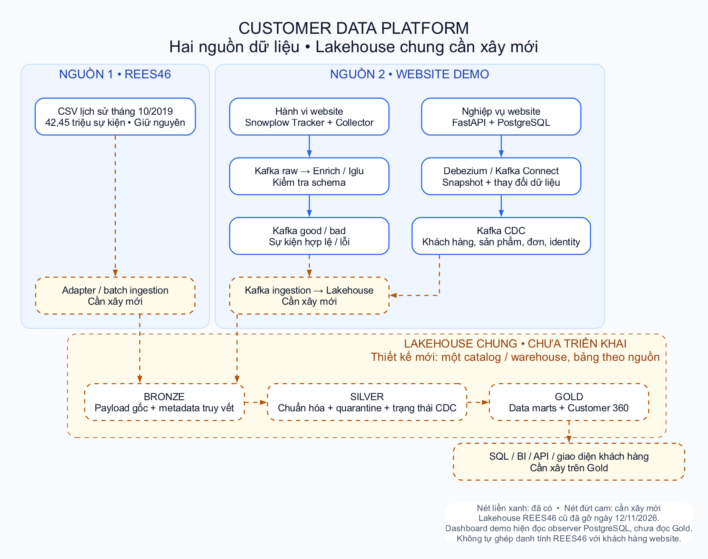
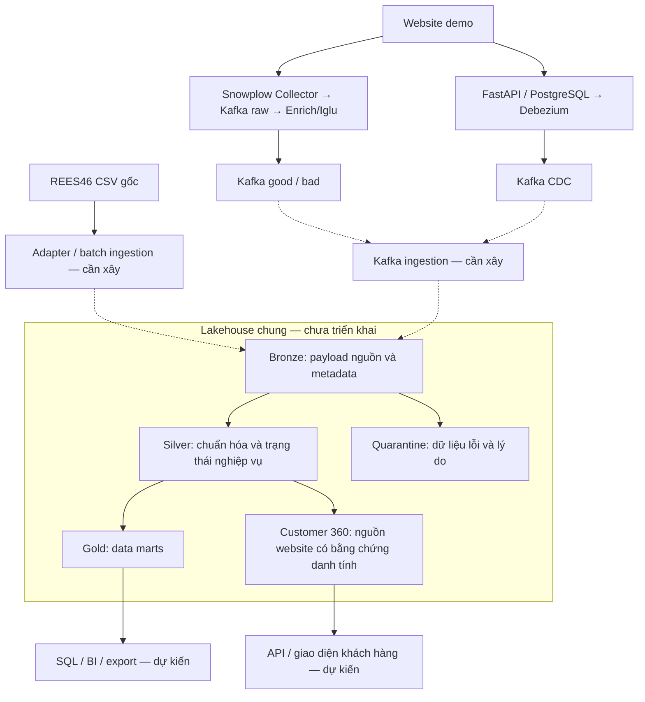

# Kế hoạch Customer Data Platform — Lakehouse chung

Cập nhật ngày 12/11/2026. Theo yêu cầu xây lại từ đầu, phần Lakehouse REES46
cũ đã được gỡ. Hiện dự án giữ hai nguồn đầu vào; Lakehouse chung trong tài liệu
này là thiết kế dự kiến, chưa có code, bảng dữ liệu hoặc hạ tầng triển khai.

## 1. Mục tiêu

Xây một Lakehouse chung để thu thập, lưu trữ, chuẩn hóa và tổng hợp:

- **REES46:** hành vi thương mại điện tử lịch sử, dùng phân tích và đánh giá
  khả năng xử lý dữ liệu lớn.
- **Website demo:** hành vi qua Snowplow/Kafka và nghiệp vụ qua
  PostgreSQL/Debezium/Kafka, dùng xây hồ sơ khách hàng và phân tích giao dịch.

Chung catalog, warehouse và các tầng Bronze/Silver/Gold không có nghĩa phải
ép mọi nguồn vào cùng một bảng hoặc ghép danh tính giữa hai tập dữ liệu.

> **Hợp đồng dữ liệu đã chốt:** [lakehouse-contract.md](lakehouse-contract.md) —
> định nghĩa bảng Bronze/Silver/Gold, grain, khoá chống lặp, quy tắc danh tính
> và bộ kiểm tra chất lượng cho từng nguồn. Phải đọc tài liệu đó trước khi
> viết job ingestion.

## 2. Trạng thái hiện tại

| Hạng mục | Trạng thái |
| --- | --- |
| CSV REES46 tháng 10/2019 | Giữ nguyên file gốc, 42.448.764 sự kiện, 5.668.612.855 byte |
| Profiling REES46 | Giữ công cụ khảo sát và `data/reports/rees46-full.json` |
| Website và API nghiệp vụ | Đã có tài khoản, catalog, đơn hàng và liên kết danh tính |
| Snowplow/Kafka | Đã có Collector, Enrich/Iglu, raw/good/bad và observer |
| PostgreSQL/Debezium/Kafka CDC | Đã có snapshot và thay đổi insert/update/delete |
| Nghiệm thu nguồn | Giữ bộ bằng chứng 24 kiểm tra PASS ngày 09/11/2026 |
| Lakehouse REES46 cũ | Đã gỡ code, cấu hình, batch, Gold export, benchmark và dữ liệu Docker |
| Lakehouse chung hai nguồn | Chưa triển khai |
| Customer 360 và API trên Gold | Chưa triển khai |

Dashboard hiện tại đọc dữ liệu observer Kafka trong PostgreSQL. Nó chưa phải
lớp phục vụ dữ liệu Gold của Lakehouse.

## 3. Nguồn đầu vào được giữ

### REES46

File `data/REES46/2019-Oct.csv` gồm các trường:

```text
event_time,event_type,product_id,category_id,category_code,brand,price,user_id,user_session
```

Khoảng thời gian từ 01/10/2019 đến hết 31/10/2019 UTC. Profiling đã khảo sát
toàn file, nhưng không chứng minh đã nạp vào Lakehouse mới. Distinct trong
profiling là ước lượng. Nguồn/ngày tải và điều kiện sử dụng bản tải chưa được
xác minh. CSV gốc không commit Git.

Công cụ còn giữ: `src/pipelines/inspect_rees46_dataset.py`, hỗ trợ profiling
và xuất prefix để xem dữ liệu. Adapter Bronze/Silver cũ đã được gỡ; các batch
mẫu cũ không còn được dùng làm đầu vào của kiến trúc mới.

### Website demo

```text
Browser/generator → Snowplow Collector → Kafka raw → Enrich/Iglu → Kafka good/bad
Website/generator → FastAPI → PostgreSQL → Debezium/Kafka Connect → Kafka CDC
```

Nguồn nghiệp vụ có customers, products, orders, order_items và identity_links.
Generator tạo hành vi và giao dịch qua API, lưu ground truth riêng để đối soát.
Xem contract, các topic và cách chạy trong [operations.md](operations.md).

## 4. Kiến trúc dự kiến





Các công nghệ dự kiến là Spark, Apache Iceberg và object storage tương thích S3.
Cấu hình triển khai, partition, checkpoint và schema sẽ được chốt khi xây mới.
Hai nguồn có bảng Bronze riêng theo contract; Silver chỉ hợp nhất những trường
có cùng ý nghĩa. Các bảng nghiệp vụ CDC giữ trạng thái theo khóa nguồn.

## 5. Nguyên tắc cho thiết kế mới

- Giữ namespace REES46 và website độc lập; không tự ghép ID giữa hai nguồn.
- Liên kết anonymous/session/customer của website cần bằng chứng xác thực.
- Sự kiện purchase quan sát không tự trở thành đơn hàng hoặc doanh thu thực thu.
  Chỉ số giao dịch dựa trên trạng thái đơn nghiệp vụ; thanh toán demo là mô phỏng.
- Lưu payload nguồn và metadata đủ để truy vết; dữ liệu lỗi giữ lý do cách ly.
- Thời gian UTC, phân biệt event time và ingestion time; tiền dùng decimal và
  currency có nguồn xác định, không tự suy ra currency cho REES46.
- Quy định khóa chống lặp, phạm vi replay và checkpoint cho từng nguồn.
  CDC phải phân biệt snapshot, insert/update/delete và tombstone.
- Không cộng các mẫu REES46 chồng lặp thành dữ liệu toàn tháng.
- Đối soát cả ID, giá trị và tổng số dòng; không chỉ dựa vào thông báo job chạy xong.

## 6. Lộ trình xây lại

1. ✅ Chốt contract chung, bảng theo nguồn, grain, khóa và chính sách lưu dữ liệu
   → [lakehouse-contract.md](lakehouse-contract.md) (19/11/2026; còn §11 chờ
   thầy/team review).
2. Thiết lập một catalog/warehouse dùng chung, cấu hình chạy local mới.
3. Xây ingestion REES46 và Kafka hành vi/CDC vào Bronze có metadata truy vết.
4. Xây Silver, quarantine, trạng thái CDC và kiểm tra replay/khôi phục.
5. Xây Gold hành vi, Gold giao dịch và Customer 360 từ nguồn website.
6. Kết nối API/dashboard với Gold, kiểm chứng đầu cuối và đo hiệu năng.

Airflow, Kubernetes và HA chỉ xem xét sau khi pipeline local được nghiệm thu.

Trước khi bước 2, cần khôi phục môi trường local: `src/demo/sources/runtime.py`
dùng lệnh POSIX `ps` nên `runtime up` không chạy được trên Windows; dependency
`kafka-python` và `snowplow-analytics-sdk` cũng chưa được cài trong `.venv`.

## 7. Phạm vi đã dọn ngày 12/11/2026

- Xóa các job Spark/Iceberg trong `src/pipelines/lakehouse/`, các job Micro →
  Iceberg cũ dùng chung helper, adapter REES46 cũ và kiểm thử tương ứng.
- Xóa script chạy/benchmark, Compose/Dockerfile Lakehouse và cấu hình Spark/S3.
- Xóa batch REES46 đã sinh, Gold export và báo cáo benchmark/cleanup cũ.
- Xóa container, network mặc định, volume catalog/storage và image riêng
  `cdp-lakehouse-spark:latest` của stack Lakehouse cũ.

CSV gốc, profiling REES46, nguồn website/Kafka/CDC và bằng chứng nghiệm thu
nguồn được giữ. Báo cáo lý thuyết Snowplow DOCX là tài liệu lịch sử, không dùng
để xác định trạng thái triển khai hiện tại. Báo cáo mới cần dựa vào tài liệu này.
