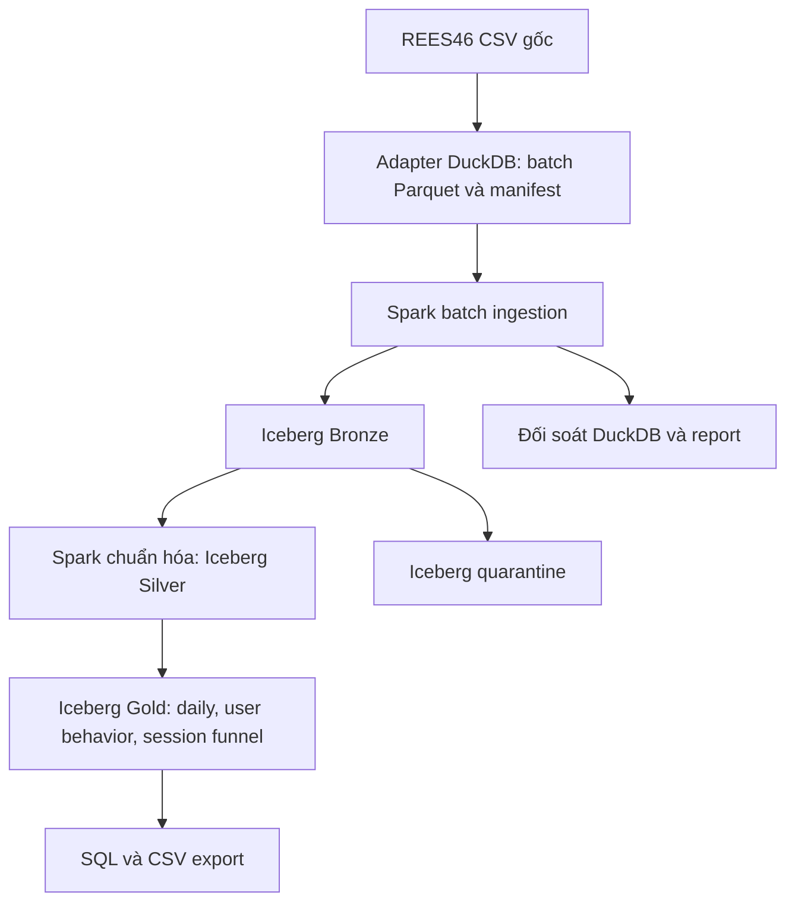

# Kế hoạch và kiến trúc Customer Data Platform

Phạm vi hiện tại tập trung vào dữ liệu hành vi REES46 và batch Lakehouse.
Hướng dẫn chạy nằm trong [development-guide.md](development-guide.md), contract
trong [data contract](development-guide.md#data-contract-rees46), kết quả đo trong
[benchmark](development-guide.md#benchmark).

## 1. Mục tiêu

Thu thập, lưu trữ, chuẩn hóa và tổng hợp dữ liệu hành vi thương mại điện tử để
phân tích hoạt động theo người dùng, ngày và hành trình theo phiên. Pipeline phải
truy vết được dữ liệu nguồn, giải trình dữ liệu lỗi và chạy lại không tăng sai
kết quả. Giai đoạn sau có thể bổ sung PostgreSQL nghiệp vụ và CDC để kết hợp
hành vi với giao dịch khi có bằng chứng liên kết hợp lệ.

REES46 là nguồn lịch sử dùng cho phát triển, replay và benchmark. ID người dùng
trong dataset không phải danh tính xác thực của khách hàng doanh nghiệp.

## 2. Phạm vi hiện tại

- Khảo sát CSV tháng 10/2019, checksum và báo cáo chất lượng.
- Mẫu theo user, giữ toàn bộ hoạt động của user trong file; có chế độ toàn file.
- Bronze, Silver, quarantine và Gold trên Apache Iceberg.
- PostgreSQL JDBC catalog, object storage tương thích S3, Spark xử lý batch.
- Gold thống kê ngày, hành vi theo user và funnel theo phiên.
- Đối soát độc lập bằng DuckDB, kiểm thử lỗi, rerun và khôi phục.
- Report hiệu năng có cấu hình máy, thời gian, dung lượng và giới hạn phép đo.
- Docker Compose cho môi trường local có lưu trữ bền vững.

Không suy ra số đơn hàng hoặc doanh thu thực thu từ sự kiện purchase của REES46.
Không cộng các batch mẫu chồng lặp để tạo kết quả toàn tháng.

## 3. Nguồn dữ liệu

### REES46 đang sử dụng

File `data/REES46/2019-Oct.csv`, dung lượng 5.668.612.855 byte, có 42.448.764
sự kiện từ 01/10/2019 tới hết 31/10/2019 UTC. Schema:

```text
event_time,event_type,product_id,category_id,category_code,brand,price,user_id,user_session
```

Nguồn/ngày tải cụ thể và điều kiện sử dụng của bản tải chưa được xác minh.
Checksum local phục vụ truy vết, chưa đối chiếu checksum nhà cung cấp.
Distinct trong profiling là ước lượng; xem [báo cáo nguồn](development-guide.md#khảo-sát-rees46-dung-lượng-lớn).
Giữ CSV gốc và không commit dữ liệu lớn vào Git.

### PostgreSQL nghiệp vụ — giai đoạn sau

Python generator có seed cố định dự kiến tạo `customers`, `products`, `orders`,
`order_items`, nhật ký insert/update/delete và ground truth lưu riêng.
Pipeline không đọc ground truth để tính kết quả. Contract nguồn, tiền tệ,
trạng thái đơn và liên kết danh tính phải được chốt trước khi triển khai.
Không ghép ID nguồn mới với REES46 chỉ vì giá trị giống nhau.

## 4. Kiến trúc



- SeaweedFS S3 lưu file dữ liệu và metadata Iceberg.
- PostgreSQL catalog giúp tìm metadata hiện hành của bảng.
- CSV nguồn, batch adapter và reports lưu dưới `data/` trên host.
- Bronze giữ payload nguồn và metadata truy vết; Silver giữ dữ liệu typed.
- Quarantine giữ bản ghi lỗi và lý do, không âm thầm bỏ dòng.
- Gold được dựng lại từ Silver, không sửa trực tiếp output để thay nghiệp vụ.

Luồng bổ sung dự kiến: PostgreSQL nghiệp vụ → Debezium/Kafka Connect → Kafka
CDC → Spark → Bronze envelope → Silver trạng thái nguồn → Gold nghiệp vụ.
Đây là kế hoạch, chưa có code CDC hoặc Customer 360 trong repository.

## 5. Quy tắc xử lý

- `view` → `product_view`; `cart` → `add_to_cart`; `purchase` → `purchase_observed`.
- Timestamp UTC; phân biệt event time và ingestion time.
- Giá decimal(18,2), không làm tròn chuỗi quá hai chữ số thập phân, không suy ra currency.
- Thiếu brand/category_code/session hoặc giá 0 được giữ và gắn cờ.
- Timestamp lỗi, event type không hỗ trợ, thiếu product/user ID hoặc giá lỗi/âm được cách ly.
- Hai dòng có payload giống nhau không mặc nhiên là một hành vi trùng.
- Event ID dựa namespace, checksum file và ordinal bản ghi nguồn.
- Rerun adapter kiểm checksum và bỏ qua batch đã có; writer Iceberg thay phần
  dữ liệu của cùng batch trong từng bảng, không append lặp.
- Một writer, commit nguyên tử theo bảng; không có transaction đa bảng hoặc
  bảo đảm exactly-once đầu cuối. Chờ report pass trước khi dùng kết quả.

Funnel có grain batch/namespace/user/session. Các bước view → cart → purchase
phải có thời gian tăng nghiêm ngặt; timestamp bằng nhau không chứng minh thứ tự.
Thiếu session không vào funnel và phải báo số lượng bị loại. Mỗi bước đếm phiên
một lần. Funnel quan sát không phải tỷ lệ chuyển đổi đầy đủ của cửa hàng.

## 6. Công nghệ và cấu trúc

Python/SQL, DuckDB cho adapter và đối soát; Spark cho xử lý; Iceberg cho bảng;
SeaweedFS cho S3 local; PostgreSQL cho JDBC catalog; Docker Compose cho vận hành.
Phiên bản ghim và cách chạy trong [hướng dẫn Lakehouse](development-guide.md#lakehouse-local).

- `src/pipelines/`: profiling, adapter, Lakehouse jobs, SQL và test.
- `src/tools/`: script chạy local.
- `config/`: Docker, Spark và S3.
- `docs/`: kiến trúc, vận hành, contract và báo cáo.
- `data/`: nguồn, batch, reports và export; không commit Git.

Airflow chỉ bổ sung khi cần lịch, retry và backfill nhiều job. Kubernetes chỉ
đưa vào sau khi pipeline local đạt nghiệm thu; không suy từ restart local thành
khả năng HA nhiều máy.

## 7. Trạng thái và lộ trình

| Mốc | Trạng thái / đầu ra |
| --- | --- |
| Profiling toàn tháng | Đã khảo sát 42.448.764 dòng |
| Mẫu 100 user | 4.312 sự kiện, đã kiểm chứng batch Lakehouse |
| Mẫu 1.000 user | 42.988 sự kiện, Gold/funnel và test đối soát pass |
| Mẫu 10.000 user | 435.937 sự kiện, Gold/funnel pass; đã đo thời gian và JVM RSS |
| Mẫu 100.000 user | 3.551.431 sự kiện hợp lệ, 93 dòng daily, 100.000 user Gold, 711.942 phiên; đối soát pass, đã export CSV |
| Chế độ `--all` | Có code và fixture; chưa chạy toàn tháng vào Iceberg. Tạm dừng theo yêu cầu |
| Partition và benchmark | Đã thêm partition theo ngày, đo batch 100.000 user; benchmark toàn tháng chưa hoàn thành |
| PostgreSQL generator và CDC | Chưa triển khai |
| Gold nghiệp vụ/Customer 360/API | Chưa triển khai; cần contract và liên kết có bằng chứng |
| Kubernetes và đánh giá khôi phục | Giai đoạn cuối |

Các mốc 100, 1.000 và 10.000 user là lịch sử kiểm chứng; batch và báo cáo trên
host đã được dọn, hiện chỉ giữ bộ kết quả 100.000 user. Ba batch cũ cũng đã
xóa khỏi Iceberg; snapshot cũ đã expire, mỗi bảng giữ snapshot hiện hành.

## 8. Nghiệm thu

- Bronze = Silver + quarantine, kiểm cả ID và giá trị, không chỉ tổng số dòng.
- Dữ liệu nguồn và metadata đủ để truy vết bản ghi; input bị sửa được phát hiện.
- Silver và Gold khớp SQL tham chiếu độc lập; kiểm trường hợp timestamp hòa,
  chuỗi đảo ngược, payload lặp và session ID dùng chung giữa user.
- Rerun giữ kết quả nghiệp vụ; khôi phục Gold bị thiếu không ảnh hưởng batch khác.
- Full-month có số liệu thời gian, RAM, disk/file sizes và cấu hình môi trường;
  không suy rộng từ mẫu có bias thành benchmark toàn nguồn.
- CDC sau này phân biệt snapshot, insert/update/delete và tombstone; đối soát
  trạng thái đích với PostgreSQL tại mốc xác định sau khi backlog xử lý hết.
- Ground truth, kịch bản kiểm thử, báo cáo expected/actual và hướng dẫn tái lập
  được lưu riêng, mọi tuyên bố hiệu năng có phép đo hoặc ghi rõ chưa đo.

## Tài liệu tham chiếu

- [REES46](https://data.rees46.com/)
- [REES46 data card](https://www.kaggle.com/datasets/mkechinov/ecommerce-behavior-data-from-multi-category-store)
- [Iceberg JDBC catalog](https://iceberg.apache.org/docs/1.11.0/docs/jdbc/)
- [Iceberg S3FileIO](https://iceberg.apache.org/docs/1.11.0/docs/aws/)
- [Spark](https://spark.apache.org/docs/3.5.8/)
- [SeaweedFS](https://github.com/seaweedfs/seaweedfs)
- [Debezium PostgreSQL connector](https://debezium.io/documentation/reference/stable/connectors/postgresql.html)
